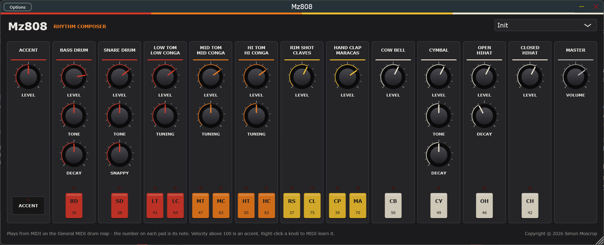

# Mz808

**A TR-808 for your DAW.** Mz808 is a VST3 instrument, and a standalone app, that emulates
the sound circuits of the Roland TR-808 Rhythm Composer of 1980: the booming kick, snappy
snare, handclap, cowbell and the rest of a few decades of hip hop, electro and pop.

Mz808 is built from the circuits, not from samples. Each of the 808's voices is modelled as
the hardware makes it - a trigger pulse kicking an oscillator or opening a VCA - so it
behaves like the machine as well as sounding like it:

- **The bass drum** from Werner, Abel and Smith's circuit analysis: the punch from the
  bridged-T's centre jumping more than an octave for the first few milliseconds, the
  retrigger that holds its level, the pitch "sigh" of a long decay, and an accented hit
  that blooms rather than just getting louder.
- **The metal.** Cymbal, hihats and cowbell share one bank of six square-wave oscillators
  that never stop, so no two cymbal hits are quite the same. The cymbal's three bands are
  after the same group's analysis of that circuit.
- **Accent as the 808 does it:** a taller trigger into circuits that do not answer to it
  linearly, not a gain at the output.
- **The shared circuits left in.** A conga cuts off its tom, claves cut off the rim shot,
  maracas cut off the clap, and a closed hihat chokes an open one, because on the hardware
  each pair is one circuit.
- **No machine-gun effect.** A fast roll adds to the ring that is still going rather than
  restarting it.

Every knob of the original panel is here, laid out as on the 808. On top of that:
- **Pads.** Sixteen pads, in the 808's step-key colours, play each sound and light up
  whenever it is struck, from the pad, the host or a controller.
- **MIDI control.** Every knob has a MIDI CC. Right-click any knob to MIDI-learn your own.
- **Hover hints.** Hover over any control to see what it does and which CC moves it.
- **Nine factory kits,** from *Long Boom* to *Electro* and *Latin*. Your own settings are
  saved with your project.

The sequencer isn't here yet. Program your patterns in the DAW, or play the sounds from a
pad controller.

Mz808 is an independent project. Roland and TR-808 are Roland's trademarks.

## Installing

Mz808 is built from source for now: see [Building](#building). The build installs the VST3
into your per-user plugin folder, `%LOCALAPPDATA%\Programs\Common\VST3`. Most DAWs find it
there. Some need the folder added to their plugin paths once; in Ableton Live it goes under
*Preferences → Plug-Ins → VST3 Plug-In Custom Folder*.

The standalone app, `Mz808.exe`, plays without a DAW. Its *Options* button chooses the audio
and MIDI devices.

### macOS (beta)

Download `Mz808-<version>-macOS-beta.zip` from the
[releases page](https://github.com/simozzer/Mz808/releases) and unzip it. It holds the VST3, an Audio Unit (for Logic and GarageBand) and the standalone app,
for Apple Silicon and Intel Macs on macOS 11 or later.

They aren't signed by Apple, which takes a paid developer account, so macOS won't open them
with a double-click. Install them from Terminal instead. Type `bash ` (with the space), drag
`install.sh` from the unzipped folder into the Terminal window, and press Return:

    bash ~/Downloads/Mz808-<version>-macOS-beta/install.sh

It copies everything into your own Library folders, with no password needed, and clears the
"downloaded from the internet" flag that would stop your DAW loading the plugin. Then rescan
plugins in your DAW. `READ ME FIRST.txt` in the zip explains how to install by hand instead.

It's a beta: built and checked on GitHub's Macs, including Apple's own Audio Unit validator,
but not yet tried on a real one. If something doesn't work, please
[open an issue](https://github.com/simozzer/Mz808/issues).

### Linux (beta)

Download `Mz808-<version>-linux-x86_64-beta.tar.gz` from the
[releases page](https://github.com/simozzer/Mz808/releases) and unpack it. It holds the VST3, an LV2 and the standalone app, for 64-bit x86 PCs on Ubuntu 22.04 or later, or another distribution as new. For a **Raspberry Pi 5** on 64-bit Raspberry Pi OS (Bookworm or
later), download `Mz808-<version>-linux-arm64-beta.tar.gz` instead; it installs the same way.
Install it with one command in the unpacked folder:

    bash install.sh

It copies the plugins into `~/.vst3` and `~/.lv2`, where Linux hosts (Ardour, Bitwig,
Reaper, Carla, Qtractor, Zrythm) look for them, with no password needed. Then rescan plugins
in your DAW. `READ ME FIRST.txt` in the archive explains how to install by hand, and the
few libraries a minimal system might need.

It's a beta: built and checked on GitHub's Ubuntu machines, but not yet tried much in real
Linux hosts. If something doesn't work, please
[open an issue](https://github.com/simozzer/Mz808/issues).

## Building

Needs Visual Studio 2022+ with *Desktop development with C++*, and JUCE checked out beside
this repository (`..\JUCE`, or pass `-DJUCE_PATH=`).

    .\build.ps1                 engine check, then the VST3 and the standalone
    .\build.ps1 -NoPlugin       engine check only
    .\build.ps1 -Wav out        and render demo patterns into out\ to listen to
    .\build.ps1 -Release        and the files a release attaches, into dist\

`-Release` also needs [Inno Setup 6](https://jrsoftware.org/isdl.php). It writes:
- `Mz808-<version>-win64-Setup.exe`: installs the VST3, the standalone or both, for
  everyone or just the current user, with an uninstaller.
- `Mz808-<version>-win64-VST3.zip` and `Mz808-<version>-win64-Standalone.zip`: for
  installing by hand, each with a README.

The version comes from `project()` in `CMakeLists.txt`. Change it there, and the binaries,
installer and file names all follow.

**Releasing.** Bump the version, write the notes in `docs/releases/v<version>.md`, then push
a matching tag (`git push origin v0.2.0`). The release workflow builds and checks everything
on GitHub, and attaches the installer and zips to a draft release with those notes, ready to
read over and publish. It refuses a tag that disagrees with `CMakeLists.txt`. It then reads
the release back from GitHub and fails unless the installer and both zips are on it. If it
fails, fix the cause and run the *release* workflow again from the Actions tab with the tag.
Once the Windows job has made the draft, a Mac job adds `Mz808-<version>-macOS-beta.zip` to it
(`.github/workflows/mac.yml`, which also runs on every push to `main` as a check).

Every push to `main`, and every pull request, builds the installer the same way (the *build*
workflow), so anything that would break it shows up straight away. Each run keeps its
installer and zips for two weeks, to try between releases.

## Layout

    Source/TR808/        the instrument - plain C++, no JUCE
      Dsp.h              filters, noise, the curves of the pots
      Trigger.h          the trigger pulse, accent, pulse shaper, envelope generators
      BridgedT.h         the drum oscillator most of the voices are built from
      Metal.h            the six square-wave oscillators, and the swing-type VCA
      BassDrum.h  SnareDrum.h  Toms.h  RimShot.h  HandClap.h
      Cowbell.h  Cymbal.h  HiHat.h
      Engine.h/.cpp      the note map, the shared circuits, the mixer
      Settings.h         the front panel, in panel units
    Source/              the JUCE plugin round it: parameters, kits, editor
    Tests/DspCheck.cpp   the engine's checks; gates the plugin build

## How it works

**References.**
- K. J. Werner, J. S. Abel and J. O. Smith, *A Physically-Informed, Circuit-Bendable,
  Digital Model of the Roland TR-808 Bass Drum Circuit*, DAFx-14.
- K. J. Werner, J. S. Abel and J. O. Smith, *The TR-808 Cymbal: a Physically-Informed,
  Circuit-Bendable, Digital Model*, ICMC-SMC 2014.
- The published oscillator frequencies of the other voices.

Below, each voice says which parts come from those sources and which are reasoned from the
circuit's structure and the sound.

**Trigger and accent.** The CPU's common trigger is ANDed with each instrument's data line
into a 1 ms pulse. Its height is the accent: the ACCENT knob sets the accented trigger
between 7 and 14 V (cymbal analysis). The unaccented trigger is taken as the bottom of that
range, which is inferred rather than stated. Each voice makes everything from that pulse:
its envelope, its kick to the oscillator, its pitch sweep. That is why an accent changes
the sound as well as the level.

**The bridged-T.** A bridged-T network in an op-amp's feedback is a high-Q band pass; kicked
by the pulse, it rings as a decaying, nearly-sine wave. It is modelled as the band pass it
is, solved with zero-delay feedback so it stays in tune when its centre moves every sample.
A pulse shaper in front passes the pulse's rising edge whole and lets a diode shave off the
falling one.

**Bass drum (TONE, DECAY).** From the DAFx-14 analysis:
- **Attack.** The bridged-T is centred at Roland's typical 56 Hz. An envelope generator
  (Q41, Q42) lifts its centre to 2.3× and its Q with it, for the pulse and about 5 ms after.
  That is the punch.
- **Retrigger.** As that envelope falls, C39, R161 and D52 kick the bridged-T again so the
  level holds.
- **Sigh.** Leakage through R161 leaves the pitch a little high for a while after.
- **DECAY** is the feedback that keeps it ringing, about 0.2 s to over 3 s to −40 dB. The
  feedback buffer's diodes clip a large ring, so an accented hit loses its top faster and
  settles into the same tail.
- **TONE** is a low pass on the output: the click, not the boom.

**Snare (TONE, SNAPPY).** Two bridged-Ts at about 238 and 476 Hz; TONE crossfades between
them. SNAPPY is the level of high-passed white noise through its own VCA.

**Toms and congas (TUNING).**
- **Shared circuit.** One circuit per pair, switched, so a conga cuts off its tom. Played
  from MIDI, the note decides which one the circuit is.
- **Pitch.** Nominal centres are toms 90, 135, 185 Hz and congas 185, 250, 400 Hz. The
  pitch sweeps down on the strike, and TUNING moves it a quarter-octave either way.
- **Noise.** The toms carry a short layer of pink noise; the congas don't.

**Rim shot and claves.** One circuit, so each cuts off the other.
- **Claves:** a single bridged-T at 2.5 kHz.
- **Rim shot:** bridged-Ts at 455 and 1667 Hz through an overdriven VCA on a very short
  envelope, then a high pass.

**Hand clap and maracas.** One circuit, so each cuts off the other.
- **Clap:** white noise through a 1 kHz band pass, opened by a burst of quick decays a few
  milliseconds apart, then a slower "reverb" tail.
- **Maracas:** high-passed noise with an envelope that rises before it falls.

**The metal.** Six Schmitt-trigger oscillators run all the time, so each hit catches them
somewhere different: 205.3, 304.4, 369.6 and 522.7 Hz, plus 540 and 800 Hz as trimmed at the
factory. Their duty cycle is 47.98% (cymbal analysis). Each edge is band-limited at its exact
sub-sample position.
- **Cowbell:** the 540 and 800 Hz pair, through a VCA with a short strike and a longer ring,
  then a band pass.
- **Cymbal (TONE, DECAY):** the six summed into band passes at 3440 and 7100 Hz (cymbal
  analysis). That feeds three bands, each through a swing-type VCA on its own envelope and
  a high pass:
  - a long low band, whose length DECAY sets;
  - a medium band;
  - a short splash through a resonant third-order high pass near 10.5 kHz.

  TONE mostly sets how much splash gets through.
- **Hihats:** the six through a band pass, a swing-type VCA and a high pass. Open and closed
  share the VCA and differ in how fast its envelope is let go, so a closed hat chokes an open
  one.

The swing-type VCA's supply is the envelope, and it is biased into clipping. That is the
808 cymbal's grit, and it stays as the sound decays.

**Mixer.** Each sound's LEVEL is an audio-taper pot, with the shared ones shared. A coupling
capacitor and the master VOLUME follow. Sounds that have rung out are put to sleep, so an
idle Mz808 costs almost nothing. All sixteen playing every 16th uses about 3% of one core.

## MIDI

Every MIDI channel plays. Notes follow the General MIDI drum map, as the 808-style drum
machines that came after it do. Velocity **above 100** is an accent; 100 and below plays
unaccented, so notes drawn at most hosts' default of 100 stay plain. Velocity does nothing else - like the hardware, a hit is either accented or not.
Note-offs are ignored, because every 808 sound runs out on its own.

| Sound | Note | | Sound | Note | | Sound | Note |
|---|---|---|---|---|---|---|---|
| Bass drum | 36 (and 35) | | Hi tom | 50 | | Maracas | 70 |
| Rim shot | 37 | | Hi conga | 62 | | Cow bell | 56 |
| Snare | 38 (and 40) | | Mid conga | 63 | | Cymbal | 49 (and 52, 55, 57) |
| Hand clap | 39 | | Low conga | 64 | | Open hihat | 46 |
| Low tom | 43 (and 41, 45) | | Claves | 75 | | Closed hihat | 42 (and 44) |
| Mid tom | 47 (and 48) | | | | | | |

Every knob has a fixed CC, in panel order, from MIDI's undefined numbers. A CC moves the
knob itself, so the panel follows and the host can record it.

| Control | CC | | Control | CC | | Control | CC |
|---|---|---|---|---|---|---|---|
| Accent | 14 | | Low tom level | 21 | | Cymbal level | 30 |
| Bass drum level | 15 | | Low tom tuning | 22 | | Cymbal tone | 31 |
| Bass drum tone | 16 | | Mid tom level | 23 | | Cymbal decay | 102 |
| Bass drum decay | 17 | | Mid tom tuning | 24 | | Open hihat level | 103 |
| Snare level | 18 | | Hi tom level | 25 | | Open hihat decay | 104 |
| Snare tone | 19 | | Hi tom tuning | 26 | | Closed hihat level | 105 |
| Snare snappy | 20 | | Rim shot level | 27 | | Volume | 7 |
| | | | Hand clap level | 28 | | | |
| | | | Cow bell level | 29 | | | |

The table lives in `Source/Params.cpp`. Each control's CC, hover hint and saved state are
defined there together.

**MIDI learn.** Right-click any knob (or its label) to open its menu:
- **MIDI Learn:** the knob is outlined in red until a CC arrives, and that CC is assigned
  to it. Right-click again to cancel.
- **Forget CC:** the knob stops answering to MIDI.
- **Restore default:** puts back the CC from the table above.
- **Reset all CCs to defaults.**

Each CC drives one knob at a time. CCs 0 and 32 (bank select) and 120 and up (channel mode)
can't be learned. Assignments are saved with the project.

## Not yet calibrated against hardware

The bass drum and cymbal follow published circuit analyses, and the oscillator frequencies
are published figures. Everything else is reasoned from each circuit's structure and from
the sound, not measured from a real TR-808:
- ring times and envelope times
- filter corners and Qs
- the clap's timing
- the snare's TONE law
- the levels between voices

The next step towards "as close as possible" is to measure a real unit and fit these
numbers. Each is a single named constant in its voice's header.

## Not yet built

- **The sequencer.** The 808's 16-step pattern sequencer, with its A/B variations, tap
  and tempo.
- **Individual outputs.** The hardware has an output per instrument; Mz808 mixes to one
  for now.

## Licence

Created by Simon Moscrop.

Mz808 is free software: you can redistribute it and/or modify it under the terms of the GNU
Affero General Public License as published by the Free Software Foundation, version 3. It
is distributed in the hope that it will be useful, but WITHOUT ANY WARRANTY; without even
the implied warranty of MERCHANTABILITY or FITNESS FOR A PARTICULAR PURPOSE. See
[LICENSE](LICENSE) for the full terms.

It is built with [JUCE](https://juce.com), used under the same licence.
